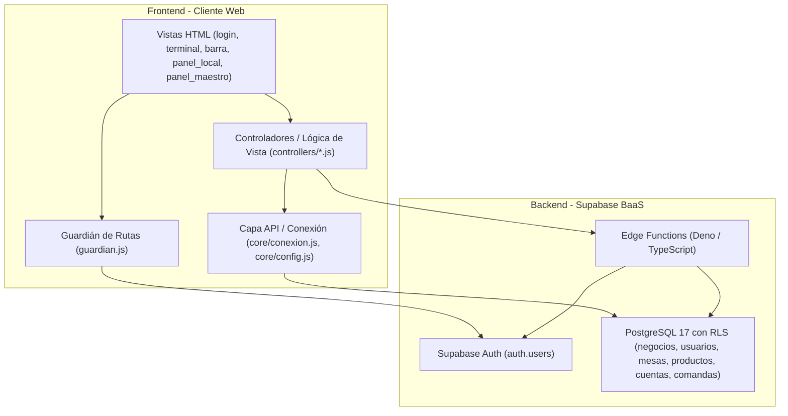

# 🏛️ 01 - Arquitectura del Sistema

Este documento describe la arquitectura técnica de **Gestor Bar**, la separación de responsabilidades y la comunicación entre capas.

---

## 📐 Diagrama de Arquitectura Global

---

## 🧩 Capas del Frontend

El frontend está diseñado actualmente como una **Aplicación Multi-Página (MPA) con JavaScript ES Modules nativo**:

### 1. Vistas (HTML)
- Páginas independientes para cada pantalla del sistema.
- Cuentan con un estilo visual inicial (`body { display: none; }`) para evitar el parpadeo de pantalla ("flash of unauthenticated content") hasta que el guardián de rutas valide la sesión.

### 2. Guardián de Rutas (`js/core/guardian.js`)
Es el componente central de seguridad en el cliente:
1. Comprueba si existe una sesión activa mediante `supabase.auth.getSession()`. Si no hay sesión, redirige a `login.html`.
2. Consulta el perfil en la tabla `usuarios` para obtener el `rol` y `negocio_id`.
3. Comprueba si el rol del usuario figura en el arreglo de `rolesPermitidos` de la página. Si no, muestra una alerta y redirige a `login.html`.
4. Si todo es correcto, inyecta la clase CSS `.autorizado` en el `body` para mostrar la interfaz y retorna el objeto con los datos del usuario.

### 3. Controladores (`js/controllers/`)
Cada vista tiene su controlador asociado:
- `login.js`: Envía credenciales a Supabase Auth y redirige según el rol.
- `maestro.js`: Administra la cartera de clientes de la plataforma SaaS (alta de negocios y administradores vía Edge Functions).
- `local.js`: Administra el catálogo de productos y el personal de la sucursal.
- `terminal.js`: Gestiona el piso del bar: mesas disponibles/ocupadas, apertura de cuentas y registro de comandas.
- `barra.js`: Monitor KDS de barra con actualización en tiempo real/polling para preparar y despachar pedidos.

### 4. Núcleo (`js/core/`)
- `config.js`: Centraliza las variables de entorno (URL de Supabase y anon key).
- `conexion.js`: Instancia el cliente de Supabase usando ES Modules desde CDN.
- `guardian.js`: Interceptor de autorización.
- `api.js`: Funciones auxiliares para interactuar con productos y comandas.

---

## ⚡ Capa Backend (Supabase & Edge Functions)

El backend delega la lógica de negocio sensible a **Edge Functions** desarrolladas en Deno y TypeScript:
- **`registrar_cliente`**: Invoca el API de administración de Supabase con `SERVICE_ROLE_KEY` para crear simultáneamente el registro en la tabla `negocios`, el usuario en `auth.users` y el perfil `admin` en `usuarios`.
- **`registrar_empleado`**: Permite a un dueño crear meseros o bartenders asociados exclusivamente a su `negocio_id` con confirmación de correo automática.
- **`editar_cliente` / `editar_empleado`**: Modificación de datos y reseteo de contraseñas de forma segura sin exponer credenciales administrativas en el frontend.

---

## 🚀 Hoja de Ruta (Roadmap hacia Vite)

Actualmente, el frontend no requiere compilación previa (basta con Live Server). Conforme el sistema sume funcionalidades (módulo CRM avanzado, reportes gráficos, exportación a Excel/PDF), la estructura evolucionará hacia:
1. **Empaquetado con Vite**: Cero configuración compleja, servidor de desarrollo ultra-rápido y soporte de `.env` nativo.
2. **Componentización de UI**: Unificación de modales de cobro, modales de edición e indicadores de usuario en componentes reutilizables.
3. **Capa de Servicios**: Desacoplar consultas directas a Supabase fuera de los controladores hacia servicios específicos (`servicios/cuentas.js`, `servicios/inventario.js`).
