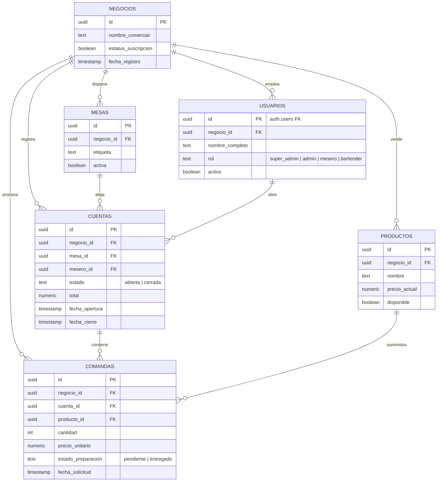

# 🗄️ 02 - Base de Datos y Aislamiento Multi-Sucursal

Este documento detalla el modelo de datos de **Gestor Bar**, el esquema de tablas en PostgreSQL y la estrategia de seguridad mediante **Row Level Security (RLS)** que garantiza el aislamiento total entre sucursales.

---

## 📊 Diagrama Entidad-Relación (ERD)



---

## 📋 Catálogo de Tablas

### 1. `negocios` (Inquilino / Sucursal)
Representa cada establecimiento o sucursal independiente.
- `id` (UUID, Primary Key): Identificador único del bar/sucursal.
- `nombre_comercial` (TEXT): Nombre público del bar (ej. "La Oveja Negra").
- `estatus_suscripcion` (BOOLEAN): Estado del servicio en el SaaS (true = activo).
- `fecha_registro` (TIMESTAMP WITH TIME ZONE): Fecha de creación en el sistema.

### 2. `usuarios` (Perfiles del Personal)
Vinculado directamente a `auth.users` de Supabase.
- `id` (UUID, Primary Key, Foreign Key -> `auth.users.id`).
- `negocio_id` (UUID, Foreign Key -> `negocios.id`): Sucursal a la que pertenece el usuario.
- `nombre_completo` (TEXT): Nombre visible del colaborador.
- `rol` (TEXT): Rol operativo: `'super_admin'`, `'admin'`, `'mesero'`, `'bartender'`.
- `activo` (BOOLEAN): Si está en false, el login rechaza el acceso inmediatamente.

### 3. `productos` (Catálogo de Menú)
- `id` (UUID, Primary Key).
- `negocio_id` (UUID, Foreign Key -> `negocios.id`).
- `nombre` (TEXT): Nombre de la bebida o alimento.
- `precio_actual` (NUMERIC): Precio de venta unitario.
- `disponible` (BOOLEAN): Bandera para borrado lógico (soft delete) y control de stock.

### 4. `mesas` (Distribución de Piso)
- `id` (UUID, Primary Key).
- `negocio_id` (UUID, Foreign Key -> `negocios.id`).
- `etiqueta` (TEXT): Nombre identificador (ej. "Mesa 1", "Barra A").
- `activa` (BOOLEAN): Si false, la mesa queda oculta sin perder historial de ventas.

### 5. `cuentas` (Cuentas / Órdenes de Mesa)
- `id` (UUID, Primary Key).
- `negocio_id` (UUID, Foreign Key -> `negocios.id`).
- `mesa_id` (UUID, Foreign Key -> `mesas.id`).
- `mesero_id` (UUID, Foreign Key -> `usuarios.id`).
- `estado` (TEXT): `'abierta'` (en consumo) o `'cerrada'` (pagada).
- `total` (NUMERIC): Monto total cobrado al cerrar la cuenta.
- `fecha_apertura` (TIMESTAMP WITH TIME ZONE): Momento en que se registró el primer producto.
- `fecha_cierre` (TIMESTAMP WITH TIME ZONE): Momento en que se liquidó la mesa.

### 6. `comandas` (Líneas de Pedido / Tickets para Barra)
- `id` (UUID, Primary Key).
- `negocio_id` (UUID, Foreign Key -> `negocios.id`).
- `cuenta_id` (UUID, Foreign Key -> `cuentas.id`).
- `producto_id` (UUID, Foreign Key -> `productos.id`).
- `cantidad` (INTEGER): Unidades solicitadas.
- `precio_unitario` (NUMERIC): Precio al momento de la orden (protege contra cambios futuros de precio).
- `estado_preparacion` (TEXT): `'pendiente'` o `'entregado'`.
- `fecha_solicitud` (TIMESTAMP WITH TIME ZONE): Timestamp para la cola FIFO del monitor de barra.

---

## 🔒 Modelo de Aislamiento Estricto (Row Level Security)

Para cumplir con la directiva de que las sucursales sean **100% aisladas e independientes sin posibilidad de filtración de datos**, PostgreSQL debe contar con políticas RLS activas en todas las tablas:

```sql
-- 1. Habilitar RLS en cada tabla
ALTER TABLE productos ENABLE ROW LEVEL SECURITY;
ALTER TABLE mesas ENABLE ROW LEVEL SECURITY;
ALTER TABLE cuentas ENABLE ROW LEVEL SECURITY;
ALTER TABLE comandas ENABLE ROW LEVEL SECURITY;

-- 2. Función auxiliar para obtener el negocio_id del usuario conectado
CREATE OR REPLACE FUNCTION get_my_business_id()
RETURNS UUID AS $$
  SELECT negocio_id FROM public.usuarios WHERE id = auth.uid() AND activo = true;
$$ LANGUAGE sql STABLE SECURITY DEFINER;

-- 3. Política de Aislamiento para Productos
CREATE POLICY "Aislamiento por negocio en productos"
ON productos FOR ALL
TO authenticated
USING (
  negocio_id = get_my_business_id()
  OR (SELECT rol FROM public.usuarios WHERE id = auth.uid()) = 'super_admin'
);

-- 4. Política de Aislamiento para Mesas, Cuentas y Comandas
CREATE POLICY "Aislamiento por negocio en mesas"
ON mesas FOR ALL TO authenticated
USING (negocio_id = get_my_business_id());

CREATE POLICY "Aislamiento por negocio en cuentas"
ON cuentas FOR ALL TO authenticated
USING (negocio_id = get_my_business_id());

CREATE POLICY "Aislamiento por negocio en comandas"
ON comandas FOR ALL TO authenticated
USING (negocio_id = get_my_business_id());
```

---

## 🔄 Versionado de Base de Datos (Migraciones)

Para evitar desincronizaciones entre desarrolladores:
1. Las modificaciones al esquema **nunca** se aplican manualmente en producción sin un script SQL.
2. Cada cambio debe guardarse en `supabase/migrations/<timestamp>_<descripcion>.sql`.
3. Al clonar el repositorio, las migraciones se aplican ejecutando:
   ```bash
   npx supabase db reset
   ```
