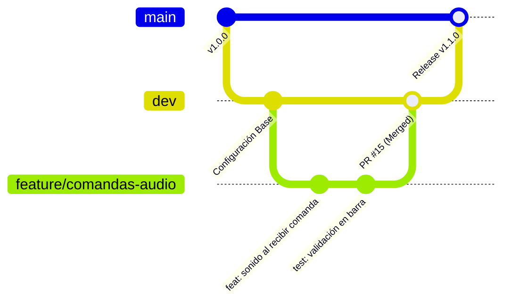
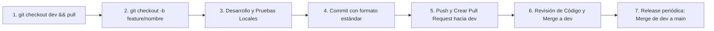

# 🤝 05 - Flujo de Trabajo Git y Colaboración

Uno de los principales desafíos en el proyecto ha sido la fricción al trabajar en equipo (conflictos en archivos de la raíz, commits directos y falta de acuerdos claros). Este documento establece el **estándar de desarrollo y colaboración** para que todo el equipo trabaje en armonía sin pisarse el código.

---

## 🌳 Modelo de Ramas (GitFlow Simplificado)



### 1. `main` (Producción Estable)
- Contiene **únicamente código probado y listo para producción**.
- **PROHIBIDO hacer `git push origin main` directamente**. Todo entra vía Pull Request desde `dev`.
- Cada merge a `main` representa una versión liberada.

### 2. `dev` (Integración)
- Es la rama base donde se integran todas las nuevas características probadas.
- Todo desarrollo parte de `dev` actualizado y regresa a `dev` mediante un Pull Request.

### 3. Ramas de Trabajo Temporales
Nombra tus ramas con prefijos descriptivos en minúsculas y guiones:
- `feature/<nombre>`: Para nuevas funcionalidades (ej. `feature/filtro-categorias`, `feature/reporte-corte-caja`).
- `fix/<nombre>`: Para corrección de errores (ej. `fix/calculo-propina`, `fix/redireccion-login`).
- `docs/<nombre>`: Para mejoras en documentación (ej. `docs/guia-onboarding`).
- `refactor/<nombre>`: Para reestructuración de código sin alterar funcionalidad visible.

---

## 📝 Convención de Commits (Conventional Commits)

Evita mensajes ambiguos como *"cambios"*, *"corrección"* o *"avances"*. Utiliza la estructura estándar:

```text
<tipo>(<alcance_opcional>): <descripción breve en presente>
```

### Tipos permitidos:
- **`feat:`** Una nueva funcionalidad para el usuario (ej. `feat(pos): agregar botón para dividir cuenta`).
- **`fix:`** Corrección de un bug (ej. `fix(barra): resolver desfase de tiempo en órdenes`).
- **`docs:`** Cambios en documentación o comentarios (ej. `docs: actualizar diagrama ERD`).
- **`style:`** Formateo, espacios o estética sin afectar la lógica.
- **`refactor:`** Reorganización de código sin añadir funcionalidad ni corregir bugs.
- **`test:`** Creación o ajuste de pruebas manuales o automatizadas.

---

## 🔄 Ciclo de Vida: De Feature a Producción



### Paso a paso:
1. **Actualizar la base**:
   ```bash
   git checkout dev
   git pull origin dev
   ```
2. **Crear tu rama de trabajo**:
   ```bash
   git checkout -b feature/panel-crm-metricas
   ```
3. **Desarrollar y probar en local**:
   Verifica en el navegador que tu cambio no rompa vistas existentes.
4. **Hacer commits atómicos y claros**:
   ```bash
   git add .
   git commit -m "feat(crm): agregar tarjetas de resumen de ventas diarias"
   ```
5. **Subir tu rama al repositorio remoto**:
   ```bash
   git push origin feature/panel-crm-metricas
   ```
6. **Abrir Pull Request (PR)** en GitHub:
   - Base branch: `dev`
   - Compare branch: `feature/panel-crm-metricas`

---

## 📋 Plantilla Estándar para Pull Requests (PR Template)

Al crear un PR en GitHub, copia y completa este formulario:

```markdown
### 📌 ¿Qué hace este Pull Request?
Describe en 2 o 3 líneas qué problema resuelve o qué funcionalidad agrega.

### 🧪 ¿Cómo se probó este cambio?
- [ ] **Test Mobile**: Probado en viewport móvil/táctil (pantalla de mesero/celular).
- [ ] **Test Full View**: Probado en pantalla de escritorio (pantalla de barra/admin).
- [ ] Inicio de sesión con el rol correspondiente (`super_admin`, `admin`, `mesero` o `bartender`).
- [ ] Comprobación visual en navegador (sin errores en la consola DevTools).
- [ ] Verificación de que no se mezclan datos entre diferentes `negocio_id`.
- [ ] Pruebas en dispositivos móviles / pantalla táctil (si aplica al POS).

### 📸 Capturas o Evidencia (Opcional)
Adjunta una captura de pantalla si hay cambios visuales.

### ⚠️ Notas para el Revisor
¿Hay alguna migración de base de datos o cambio en `.env` requerido?
```

---

## 🛡️ Prevención de Conflictos en Git (Best Practices)

1. **Trabajar en módulos separados**: La nueva arquitectura de vistas (`views/crm/`, `views/pos/`, `views/kds/`) asigna a cada desarrollador un módulo distinto, eliminando colisiones en archivos compartidos de la raíz.
2. **Hacer pull frecuente de `dev`**: Si tu rama de feature toma más de 2 días, reincorpórale los cambios de `dev`:
   ```bash
   git checkout feature/tu-rama
   git merge dev
   ```
3. **Nunca subas archivos del sistema operativo**: `.DS_Store`, `Thumbs.db`, carpetas `.idea` o `.vscode` innecesarias deben ignorarse en `.gitignore`.
